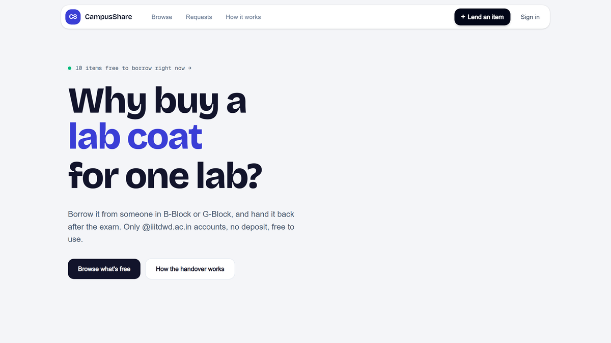
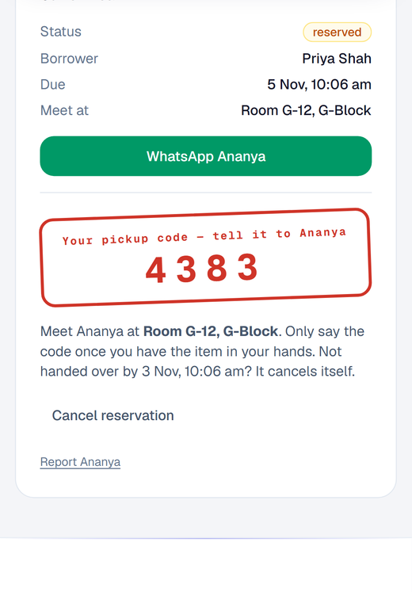
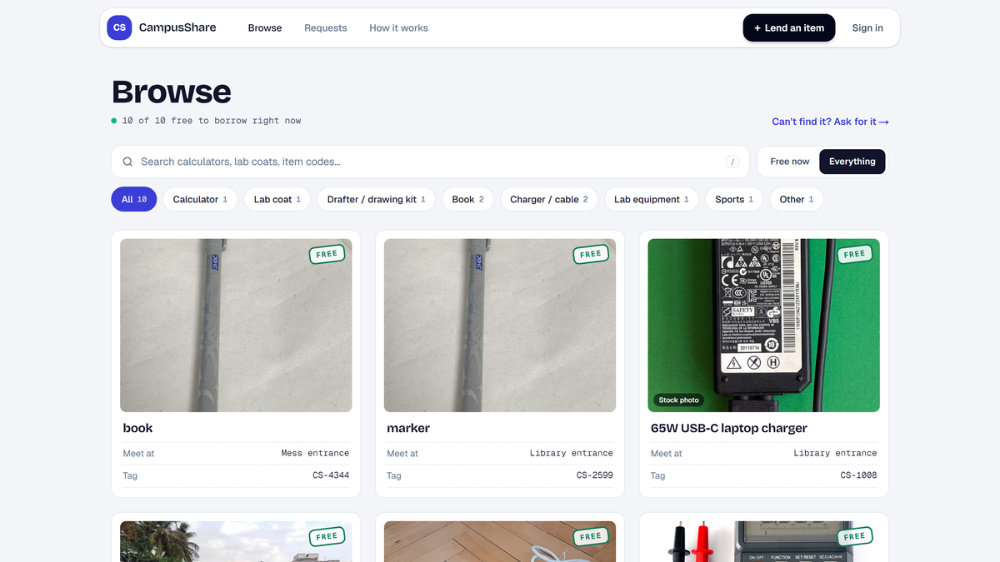
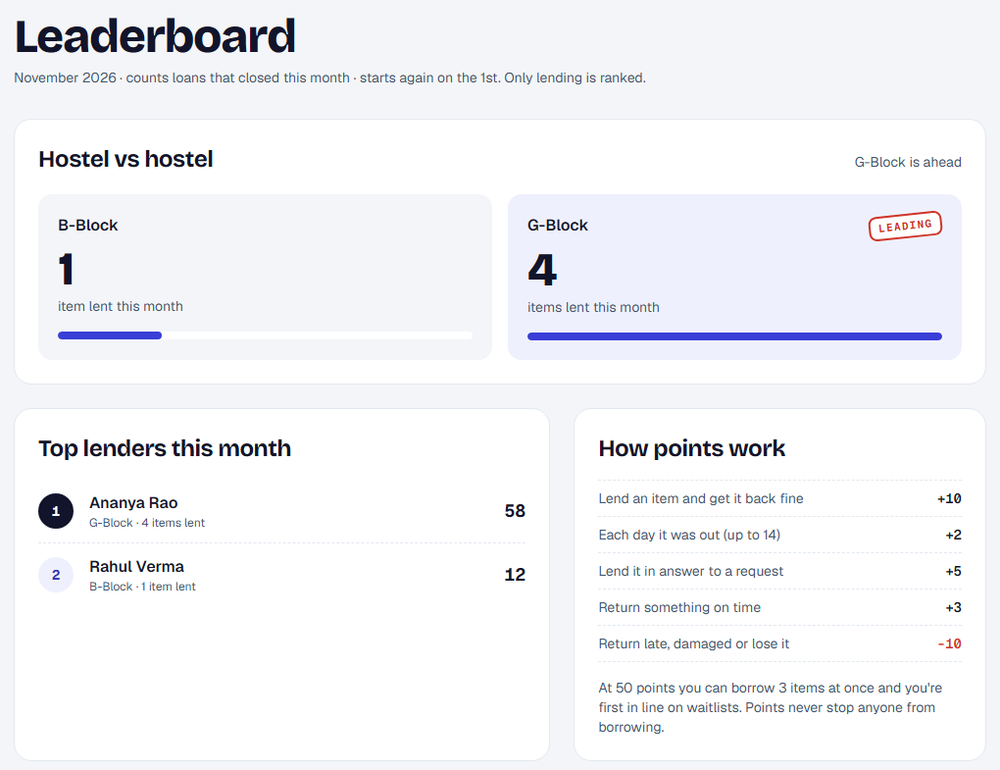

<p align="center">
  
</p>

<h1 align="center">CampusShare</h1>

<p align="center">
  <b>Borrow what you need. Lend what you don't.</b><br>
  A free lending app for IIIT Dharwad students. Frugal Innovation course project.<br>
  <a href="https://campusshare-black.vercel.app/">campusshare-black.vercel.app</a>
</p>

<p align="center">
  
</p>

---

## The problem

Students buy things they use three or four times a semester: a scientific
calculator for one exam, a lab coat for one lab block, a drafter for Engineering
Graphics. Each costs ₹300 to ₹2,000, then sits in a cupboard.

Borrowing today means posting in a WhatsApp group. Requests get buried within
minutes, nobody knows what exists or whether it's free, there's no record of who
took what, and no reminder to give it back. So lenders stop lending.

## How a loan works

1. **Reserve.** The borrower taps Reserve and gets a 4-digit **pickup code**. Only they can see it.
2. **Meet.** Same hostel: at the lender's room. Different hostels: a busy public spot the lender chose.
3. **Hand over.** The lender takes a condition photo and types the borrower's code. Now it's borrowed.
4. **Return.** The borrower takes a second photo and types the lender's **return code**. The lender checks and closes the loan.

It works like a food-delivery OTP. Nobody can be handed an item, or claim it came
back, without the other person's code.

<p align="center">
  
</p>

### Where students meet

Each student sets their hostel once on their profile. The app then picks the place:

| Lender and borrower | Meeting place |
|---|---|
| Same hostel, lender allows room pickup | The lender's room, shown only to that borrower |
| Different hostels | Library entrance, Academic e-block entrance, KRC or M-Block, or Main gate security desk |

Hostels and meeting spots are set in [`lib/campus.ts`](lib/campus.ts).

## Features

**Finding things**
- Browse with live search, category chips with counts, and a Free now / Everything switch
- Library-card style cards with an ink stamp: FREE, RESERVED, OUT · back THU, PAUSED
- Items without a photo get a credited stock photo from Wikimedia Commons, labelled "Stock photo"
- Can't find it? Post a **request**. Anyone who has one can lend it in one tap, and requests can be shared on WhatsApp

<p align="center">
  
</p>

**Trust without a deposit**

| Rule | Why |
|---|---|
| Only `@iiitdwd.ac.in` Google accounts can sign in | Every loan is tied to a real roll number |
| Two one-time codes, pickup and return | Neither side can fake a handover or a return |
| Two condition photos, at handover and at return | Damage is visible, not arguable |
| At most 2 items at a time | Nobody hoards everything before exams |
| Two late or problem returns pause borrowing for 14 days | Late returns have a cost |
| A reservation not handed over in 24 hours cancels itself | No-shows don't block items |
| 5 wrong codes issue a fresh code | Codes can't be guessed |
| Busy item? Join the waitlist; it's held for the next person for 12 hours | Fair queue when demand is high |

**Why students lend: karma, perks and pride**

| Action | Points |
|---|---|
| Lend an item and get it back fine | +10 |
| Each day it was out (up to 14) | +2 |
| Lend it in answer to a request | +5 |
| Return something on time | +3 |
| Return late, damaged or lose it | −10 |

- At **50 points** a student can hold 3 items instead of 2, and is first in line on waitlists
- Levels: Newcomer, Helper (25), Trusted lender (50), Campus champion (100), shown as badges
- A monthly **leaderboard**: B-Block against G-Block, plus the top lenders. Only lending is ranked, so nobody is shamed for borrowing
- Borrowers can leave a one-line **thank-you note** that shows on the lender's profile
- Points are worked out from real loan history every time, never stored, so nobody can edit their own score

<p align="center">
  
</p>

## It costs nothing to run

| What it needs | Service | Cost |
|---|---|---|
| Website hosting | Vercel free plan | ₹0 |
| Database | Neon Postgres free plan | ₹0 |
| Sign-in | Google, college accounts | ₹0 |
| Stock photos | Wikimedia Commons, credited | ₹0 |
| Printing and hardware | Not needed | ₹0 |

The first design used printed QR stickers and a lending box, about ₹121. Both were
dropped: students meet and swap a code instead, which is cheaper and safer.

## Interesting problems we solved

### Two students tap Reserve at the same moment

The obvious code is wrong:

```ts
const item = await db.item.findUnique({ where: { id } })
if (item.status === "AVAILABLE") {   // both requests pass this check
  await db.item.update({ ... })      // both succeed: item promised twice
}
```

The fix moves the check *inside* the write, so the database decides:

```ts
const claimed = await db.item.updateMany({
  where: { id, status: "AVAILABLE" },
  data: { status: "RESERVED" },
})
if (claimed.count === 0) throw new Error("Someone just reserved this item")
```

Every later step works the same way. Handover, return, cancel and the owner's
check all go through one `transition()` helper in
[`app/actions/loans.ts`](app/actions/loans.ts), so two taps can never overwrite
each other. The full list of bugs found and fixed is in [`BUGS.md`](BUGS.md).

### Pages took 1 to 3 seconds

The app ran in Washington DC while the database was in Singapore, so every query
crossed the Pacific. Running the app in Singapore (`vercel.json`) brought server
response times down to about a quarter of a second:

| Page | Before | After |
|---|---|---|
| Home | 1.2–2.6 s | 0.22 s |
| Browse | 1.7–1.9 s | 0.26 s |
| Item page | 2.3–3.1 s | 0.24 s |

Photos are also served as cached image files instead of being pasted into pages,
which cut the Browse page from 1,390 KB to about 410 KB.

## Tech stack

| Layer | Choice | Why |
|---|---|---|
| Framework | Next.js 16 (App Router) | Server Actions mean no separate API server to host or pay for |
| Database | PostgreSQL on Neon | Real constraints and atomic updates; free plan |
| ORM | Prisma | Typed queries |
| Sign-in | Auth.js v5 with Google | The college email *is* the identity |
| Styling | Tailwind CSS v4 | One design system in `app/globals.css` |
| Motion | Motion, Lenis, GSAP | Smooth scrolling everywhere; GSAP loads on the landing page only |
| Images | Next.js Image | Small WebP/AVIF files from our own domain |
| Hosting | Vercel, Singapore region | Next to the database |

## Project structure

```
app/
  actions/        Server Actions: loans (the state machine), items, requests, profile
  items/          Browse, item page, lend form
  dashboard/      What's waiting for you, what you borrow and lend
  requests/       The requests board
  leaderboard/    Hostel battle and top lenders
  profile/        Hostel, room, phone, karma and thank-you notes
  photo/          Serves stored photos as cached image files
  api/cron/       Daily reminder job
components/       UI: navbar, footer, landing sections, cards, loan forms
lib/
  campus.ts       Hostels, meeting spots and loan rules (edit these)
  karma.ts        Points, levels, perks and the leaderboard
  rules.ts        Borrowing limits, strikes, waitlist, housekeeping
  stockImage.ts   Finds stand-in photos on Wikimedia Commons
prisma/schema.prisma
```

## Running it locally

You need Node.js 20+, a free [Neon](https://neon.tech) database and a Google
OAuth client.

1. Create `.env` in the project folder:

   ```
   DATABASE_URL=postgres://...        # from Neon
   AUTH_SECRET=...                    # any long random string
   AUTH_GOOGLE_ID=...                 # Google Cloud console, OAuth client
   AUTH_GOOGLE_SECRET=...
   ALLOWED_EMAIL_DOMAIN=iiitdwd.ac.in
   ```

   In the Google OAuth client, add the redirect URL
   `http://localhost:3000/api/auth/callback/google`.

2. Install, create the tables, add demo items and start:

   ```
   npm install
   npx prisma db push
   npm run db:seed
   npm run dev
   ```

3. Open http://localhost:3000 and sign in with a college account.

**Optional settings** (also add these in Vercel → Settings → Environment Variables):

| Variable | What it does |
|---|---|
| `SEMESTER_END` | `YYYY-MM-DD`; no loan can run past this day |
| `RESEND_API_KEY`, `EMAIL_FROM` | Turn on email alerts and "due tomorrow" reminders |
| `CRON_SECRET` | Protects the daily reminder job |
| `NEXT_PUBLIC_APP_URL` | The site's public address, used in links and emails |

**Deploying a change to the database schema:** run `npx prisma db push` against
the live database *before* pushing the code, or the new pages will error.

## Testing

Every scenario was run end to end in a real browser with Playwright, using fake
students on a local copy of the database: reserving, both codes, wrong codes,
extensions, early returns, problems, losses, the waitlist, auto-cancel, the borrow
limit, strikes, requests, rewards and phone layouts. The manual checklist to run
before a demo is in [`BUGS.md`](BUGS.md).

## Known trade-offs and next steps

- **Free database sleeps.** Neon's free plan pauses after 5 minutes idle, so the
  first visit after a quiet spell takes 1 to 2 seconds longer.
- **Photos live in Postgres.** They're compressed to about 80 KB each and served
  as cached files. Fine for a campus pilot; object storage is the next step at
  thousands of items.
- **Emails are off by default.** They need a Resend key.
- **Next:** a pilot with real students in B-Block and G-Block, and a department
  certificate for the top lenders each semester.
